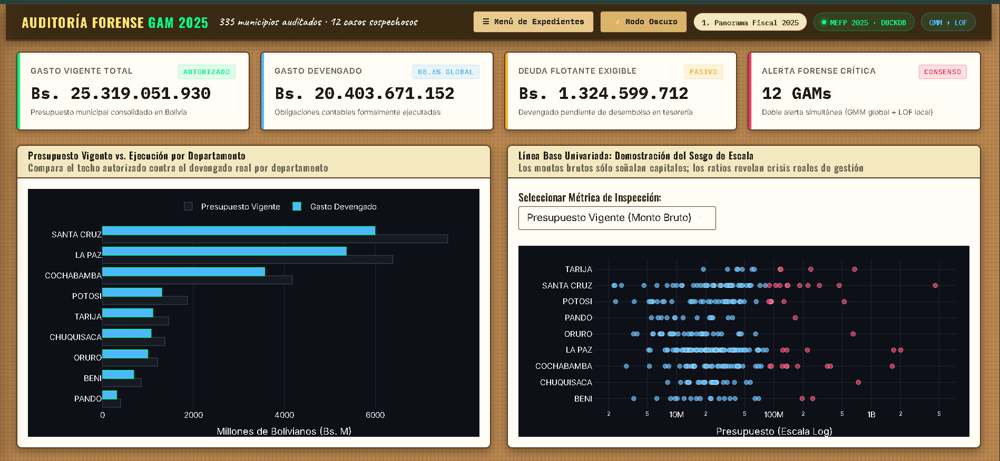

# Auditoría Forense Presupuestaria de Gobiernos Autónomos Municipales de Bolivia (Gestión 2025)

[](https://www.r-project.org/)
[-success?logo=render)](https://gmm-lof-deteccion-anomalias-auditoria.onrender.com/)
[](https://github.com/YoshGreen/GMM-LOF-DETECCION-ANOMALIAS-auditoria-fiscal-bolivia-2025)
[](https://abierto.economiayfinanzas.gob.bo/)
[](https://shiny.posit.co/)
[](https://duckdb.org/)
[](https://www.docker.com/)
[](https://www.latex-project.org/)

Sistema integral de **Minería de Datos y Auditoría Forense Computacional** para la detección no supervisada de anomalías fiscales, distorsiones presupuestarias y señales de fraude en los **335 Gobiernos Autónomos Municipales (GAM) de Bolivia** durante la **gestión fiscal 2025**.

El proyecto cruza las ejecuciones microcontables oficiales de **Gastos** (429.753 partidas) e **Ingresos** (14.644 rubros) provistas por el **Ministerio de Economía y Finanzas Públicas (MEFP)**, superando el sesgo de escala demográfica mediante ratios relativos y aplicando modelos probabilísticos y de densidad espacial: **Gaussian Mixture Models (GMM)** y **Local Outlier Factor (LOF)**, con verificación forense mediante la **Ley de Benford** y análisis de fraccionamiento de compras.

---

## Vista Previa y Estructura del Dashboard Interactivo

El sistema cuenta con un panel analítico en **R Shiny** (`bslib` + `plotly` + `DT`) bajo el estándar visual forense *Dark Telemetry*, organizado en un **menú lateral izquierdo responsivo** con 8 secciones de investigación:

1. **Panorama Fiscal 2025**: KPIs ejecutivos, presupuesto vs. devengado departamental y línea base univariada (Tukey/Z-score).
2. **Regímenes GMM & Densidad LOF**: Proyección latente PCA interactiva con controles de sensibilidad (`minPts` y umbral LOF).
3. **Consenso de Anomalías**: Matriz de cuadrantes (Log-Densidad GMM vs. Score LOF) y padrón municipal auditado DT buscable y exportable.
4. **Expediente de Evidencias (Drill-Down)**: Ficha pericial por municipio, prueba de Benford (primer dígito), donut por objeto de gasto y balance de liquidez.
5. **Tablero de Investigación (Corcho Criminalístico)**: Fichas periciales unidas con hilos rojos interactivos que agrupan municipios por causal de atipicidad (Deuda e iliquidez, Déficit de tesorería, Cero inversión, Parálisis fiscal, Fraccionamiento de compras).
6. **Telemetría Split-Flap & Cinta de Sumadora**: Tablero mecánico de caracteres que giran y cinta contable que se imprime paso a paso con código de barras y sello de "OBSERVADO".
7. **Gráficas Comparativas de Riesgo**: Cuadrantes de Inversión vs. Deuda, No Conformidad Benford (MAD de Nigrini) y Tasa de Partidas Duplicadas.
8. **Bitácora KDD & Reproducibilidad Científica**: Registro detallado de cada fase metodológica con comandos CLI de ejecución reproducible.



---

## 🏛️ Información Académica y Enlaces Públicos

- **Institución:** Universidad Mayor de San Andrés (UMSA)
- **Facultad:** Facultad de Ciencias Puras y Naturales (FCPN)
- **Carrera:** Licenciatura en Informática
- **Materia:** Minería de Datos (Gestión 2026)
- **Docente:** M.Sc. Menfy Morales Rios
- **Estudiante:** Cordova Avendaño Yoshua Aaron
- **🌐 Aplicación Web en Vivo (Render):** [https://gmm-lof-deteccion-anomalias-auditoria.onrender.com/](https://gmm-lof-deteccion-anomalias-auditoria.onrender.com/)
- **💻 Repositorio GitHub Oficial:** [https://github.com/YoshGreen/GMM-LOF-DETECCION-ANOMALIAS-auditoria-fiscal-bolivia-2025](https://github.com/YoshGreen/GMM-LOF-DETECCION-ANOMALIAS-auditoria-fiscal-bolivia-2025)
- **📊 Fuente de Datos Oficial (MEFP):** [https://abierto.economiayfinanzas.gob.bo/](https://abierto.economiayfinanzas.gob.bo/)

---

## 🔬 Metodología KDD y Flujo Científico

```text
[Datos Crudos MEFP 2025] ──► (Gastos: 429k filas | Ingresos: 14k filas)
             │
             ▼ [Fase 1: KDD con DuckDB en Disco]
       Poda GAM + Auditoría Contable (Nulos, Negativos, Inconsistencias)
       Cruce por Entidad ──► 9 Ratios Financieros Invariantes a Escala
             │
             ▼ [Fase 2: Línea Base Univariada]
       Tukey (1.5 IQR / 3.0 IQR) & Z-score ──► Demostración del Sesgo de Escala
             │
             ▼ [Fase 3: Modelado Multivariante No Supervisado]
       ├─► GMM (mclust): Algoritmo EM, Modelo VVE óptimo (G=4), Log-Densidad < p5
       └─► LOF (dbscan): MinPts=20, Umbral LOF > 1.5, Sensibilidad Multiescala
             │
             ▼ [Fase 4: Consenso y Auditoría Forense]
       12 Municipios en Doble Alerta (GMM + LOF) ──► Inspección de Partidas Crudas
       ├─► Test de Primer Dígito (Ley de Benford: Chi-cuadrado y MAD)
       └─► Detección de Montos Duplicados Reiterados (Fraccionamiento de Compras)
```

### 1. Variables Financieras Normalizadas (Invariantes a la Escala)
Para evitar que municipios grandes (Santa Cruz de la Sierra, La Paz, El Alto, Cochabamba) monopolicen las alertas solo por volumen demográfico, se formularon 9 indicadores relativos por municipio:

1. **`tasa_ejecucion_gasto`**: Gasto Devengado / Gasto Vigente.
2. **`tasa_modificacion_gasto`**: (Vigente - Inicial) / Inicial.
3. **`brecha_pago`**: (Devengado - Pagado) / Devengado (Deuda flotante exigible).
4. **`ratio_inversion`**: Inversión en Proyectos Reales / Gasto Devengado.
5. **`ratio_serv_nopers`**: Gasto en Servicios No Personales (Grupo 20000) / Gasto Devengado.
6. **`balance_caja_real`**: (Ingreso Percibido - Gasto Pagado) / Ingreso Percibido.
7. **`eficacia_recaudacion`**: Ingreso Percibido / Ingreso Vigente.
8. **`dependencia_tgn`**: Transferencias del Tesoro General de la Nación / Ingreso Percibido.
9. **`log_presupuesto`**: $\ln(1 + \text{Vigente})$.

---

## 🚨 Hallazgos Forenses Clave (12 Municipios Priorizados)

La intersección de **GMM** (baja densidad global/contextual) y **LOF** (aislamiento en vecindad $k$-NN) aisló **12 municipios en consenso de alto riesgo**:

| Municipio | Depto. | Clasificación | Hallazgo Forense Crítico |
| :--- | :--- | :--- | :--- |
| **Caquiaviri** | La Paz | Consenso (GMM + LOF) | **Violación de la Ley de Benford** ($\chi^2 = 16,91$, $p = 0,031$, $MAD = 0,0241$). Sesgo anómalo en primer dígito. |
| **Tahua** | Potosí | Consenso (GMM + LOF) | **0,00% de Inversión Pública**. Todo el presupuesto se consumió en gasto corriente. |
| **Chulumani** | La Paz | Consenso (GMM + LOF) | **Peor tasa de ejecución de Bolivia (31,87%)** con alta deuda flotante (16,20%). Parálisis de gestión. |
| **Boyuibe** | Santa Cruz | Consenso (GMM + LOF) | **19,86% de partidas en montos duplicados**. Concentración en límites de contratación menor. |
| **Colcha "K"** | Potosí | Consenso (GMM + LOF) | **15,32% de transacciones en montos reiterados** y sobredependencia fiscal. |
| **Mojinete** | Potosí | Consenso (GMM + LOF) | Superávit de caja distorsionado (46,67%) por subejecución extrema del gasto. |
| **Humanata** | La Paz | Consenso (GMM + LOF) | Aislamiento multivariante por alta brecha de pago y baja captación propia. |
| **San Juan** | Santa Cruz | Consenso (GMM + LOF) | Asimetría de balance de caja y alta modificación presupuestaria. |
| **Antequera** | Oruro | Consenso (GMM + LOF) | Rigidez presupuestaria y atipicidad local en servicios no personales. |
| **Malla** | La Paz | Consenso (GMM + LOF) | Vulnerabilidad fiscal extrema y alta dispersión en ratios operativos. |
| **Colpa Bélgica** | Santa Cruz | Consenso (GMM + LOF) | Desfase severo entre flujo de caja percibido y obligaciones devengadas. |
| **Santa Cruz de la Sierra** | Santa Cruz | Consenso (GMM + LOF) | Atipicidad de escala y estructura combinada con anomalía local de pasivos flotantes. |

---

## 🚀 ¿Cómo Correr el Proyecto?

### Opción 1: Correr el Dashboard Interactivo en Local (Recomendado)

#### Requisitos
Tener instalado [R](https://cloud.r-project.org/) (versión 4.3 o superior).

#### Pasos en Terminal / PowerShell:
```powershell
# 1. Clonar el repositorio
git clone https://github.com/YoshGreen/GMM-LOF-DETECCION-ANOMALIAS-auditoria-fiscal-bolivia-2025.git
cd GMM-LOF-DETECCION-ANOMALIAS-auditoria-fiscal-bolivia-2025

# 2. Instalar los paquetes necesarios en R (si no los tienes)
Rscript -e "install.packages(c('shiny', 'bslib', 'plotly', 'DT', 'dplyr', 'scales', 'arrow'))"

# 3. Iniciar la aplicación interactiva
Rscript -e "shiny::runApp('dashboard', launch.browser = TRUE)"
```
La aplicación se abrirá automáticamente en tu navegador web predeterminado en `http://127.0.0.1:3838`.

#### Desde RStudio:
1. Abre el archivo `dashboard/app.R` en RStudio.
2. Haz clic en el botón superior derecho **"Run App"**.

---

### Opción 2: Despliegue en la Nube con Docker en Render.com

El proyecto incluye un `Dockerfile` optimizado y multi-etapa con `.dockerignore` que empaqueta únicamente la aplicación y los datos procesados ligeros (< 300 KB):

1. Ve a tu cuenta en [Render.com](https://dashboard.render.com).
2. Haz clic en **"New +"** y selecciona **"Web Service"**.
3. Conecta tu repositorio de GitHub: `YoshGreen/GMM-LOF-DETECCION-ANOMALIAS-auditoria-fiscal-bolivia-2025`.
4. Render detectará automáticamente el archivo `Dockerfile`:
   - **Environment:** Docker
   - **Plan:** Free
5. Haz clic en **"Deploy Web Service"**.
6. En pocos minutos tendrás la URL pública activa: [https://gmm-lof-deteccion-anomalias-auditoria.onrender.com/](https://gmm-lof-deteccion-anomalias-auditoria.onrender.com/).

---

### Opción 3: Re-ejecutar el Pipeline de Datos y Modelos desde Cero

Si deseas volver a procesar los datos crudos del MEFP y regenerar todas las tablas y gráficos:

```powershell
# 1. Poda KDD con DuckDB, cruce y cálculo de los 9 ratios
Rscript scripts/01_limpieza_kdd_duckdb.R

# 2. Línea base univariada (Tukey 1.5/3 IQR, Z-score)
Rscript scripts/02_linea_base_univariada.R

# 3. Modelado multivariante (GMM mclust + LOF dbscan)
Rscript scripts/03_modelos_gmm_lof.R

# 4. Auditoría forense digital (Ley de Benford + Duplicados)
Rscript scripts/04_auditoria_benford_fraude.R
```

---

### Opción 4: Compilar el Informe Académico en LaTeX

El informe formal de 15 páginas con carátula UMSA, figuras en 300 DPI y bibliografía BibTeX se encuentra en `informe/`:

```powershell
cd informe
pdflatex -interaction=nonstopmode informe.tex
bibtex informe
pdflatex -interaction=nonstopmode informe.tex
pdflatex -interaction=nonstopmode informe.tex
```
El documento final generado es `informe/informe.pdf`.

---

## 📁 Estructura del Repositorio

```text
.
├── Dockerfile                   # Configuración para despliegue en Render.com
├── .dockerignore                # Optimización de build Docker
├── .gitignore                   # Exclusión de datos crudos pesados y binarios locales
├── README.md                    # Documentación del proyecto
├── data/
│   ├── raw/                     # Datos crudos MEFP 2025 (Gastos e Ingresos, ignorados en git)
│   └── processed/               # Datasets procesados ligeros (< 300 KB)
│       ├── municipios_fiscal_2025.rds
│       ├── municipios_fiscal_2025.parquet
│       ├── auditoria_limpieza_2025.rds
│       └── consenso_anomalias_2025.rds
├── scripts/
│   ├── 01_limpieza_kdd_duckdb.R      # KDD y consolidación analítica en DuckDB
│   ├── 02_linea_base_univariada.R    # Línea base Tukey & Z-score
│   ├── 03_modelos_gmm_lof.R          # GMM (mclust) y LOF (dbscan)
│   └── 04_auditoria_benford_fraude.R # Ley de Benford y análisis de duplicados
├── dashboard/
│   ├── app.R                         # Aplicación interactiva R Shiny (bslib, plotly, DT)
│   └── www/
│       └── custom.css                # Estilo forense Dark Telemetry (DESIGN.md)
└── informe/
    ├── informe.tex                   # Informe académico completo en LaTeX con carátula UMSA
    ├── informe.pdf                   # Documento PDF final compilado (15 páginas)
    ├── referencias.bib               # Bibliografía científica en BibTeX
    ├── figuras/                      # Gráficos en 300 DPI generados desde R
    └── tablas/                       # Tablas en formato .tex generadas automáticamente
```

---

## 📜 Licencia y Reconocimiento

Este proyecto fue desarrollado con fines de investigación académica en la **Carrera de Informática de la Universidad Mayor de San Andrés (UMSA)**. Los datos primarios provienen del portal de datos abiertos del **Ministerio de Economía y Finanzas Públicas de Bolivia (MEFP)** para la gestión fiscal 2025.
